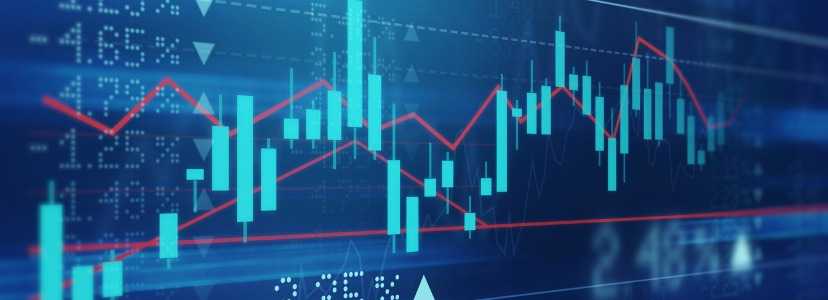

# বাংলাদেশের অর্থবাজারে খুচরা বিনিয়োগকারী বনাম প্রাতিষ্ঠানিক খেলোয়াড়

### আন্তর্জাতিক স্টক বিনিয়োগ, স্থানীয় ব্যাংক ডিপোজিট ও ডলারের বাস্তবতা: একটি তুলনামূলক আর্থিক গবেষণা

<!-- ছবির লিংক পরিবর্তন করতে উপরের src="..." অংশে নতুন লিংক বসিয়ে দিন -->

বাংলাদেশি খুচরা ট্রেডারদের সিস্টেমিক ফ্রিকশন, রিটার্ন তুলনা ও প্রাতিষ্ঠানিক সুযোগ সমীক্ষা

---

## 📌 গবেষণার সারসংক্ষেপ

| বিষয় | বিবরণ |
|---|---|
| **গবেষণার শিরোনাম** | বাংলাদেশের অর্থবাজারে খুচরা বিনিয়োগকারী বনাম প্রাতিষ্ঠানিক খেলোয়াড় |
| **গবেষণার বিষয়** | আন্তর্জাতিক স্টক বনাম লোকাল ব্যাংক (FDR), বিশেষায়িত ট্রেডিং ও ডলার |
| **প্রতিবেদনের বছর** | ২০২৬ |
| **তুলনামূলক বিশ্লেষণের সময়কাল** | ১ বছর (১২ মাসের বিনিয়োগ চক্র), ২০২৫–২০২৬ সালের বাজার ধারণার ভিত্তিতে |
| **বিশ্লেষিত স্টক** | গুগল (Alphabet Inc.); প্রসঙ্গক্রমে অ্যাপল (Apple Inc.) |
| **বিশ্লেষিত ক্যাপিটাল** | ৳৪২,৮০০ (প্রায় ৩২২ মার্কিন ডলারের সমপরিমাণ) |
| **তুলনার মানদণ্ড** | স্থানীয় ব্যাংক এফডিআর (৮% সুদ) বনাম আন্তর্জাতিক স্টক (১৭% বার্ষিক প্রবৃদ্ধি) |
| **প্রতিবেদন সংস্করণ** | ২.০ (সম্পূর্ণ আপডেটেড) |

> **⚠️ গুরুত্বপূর্ণ নোট:** এই গবেষণার সকল সংখ্যা (১৭% প্রবৃদ্ধি, ৮% এফডিআর সুদ, ১০% AIT, বিনিময় ফি ইত্যাদি) একটি **উদাহরণমূলক পরিস্থিতি (Illustrative Scenario)** ধরে হিসাব করা হয়েছে। বাস্তব হার, ফি ও আইন সময়ের সাথে পরিবর্তিত হয়। এটি কোনো আর্থিক বা আইনি পরামর্শ নয়; সিদ্ধান্ত নেওয়ার আগে হালনাগাদ তথ্য যাচাই করুন।

---

## 📑 সূচিপত্র

1. [প্রাতিষ্ঠানিক সূচনা ও পটভূমি](#১-প্রাতিষ্ঠানিক-সূচনা-ও-পটভূমি)
2. [লেনদেন ট্র্যাকিং ও ফ্রিকশন কস্ট অডিট](#২-লেনদেন-ট্র্যাকিং-ও-ফ্রিকশন-কস্ট-অডিট)
3. [তুলনা: আন্তর্জাতিক স্টক বনাম ব্যাংক এফডিআর](#৩-তুলনা-আন্তর্জাতিক-স্টক-বনাম-ব্যাংক-এফডিআর)
4. [ব্যক্তিগত ট্রেডার বনাম ব্যাংক: সুযোগ-সুবিধার তুলনা](#৪-ব্যক্তিগত-ট্রেডার-বনাম-ব্যাংক-সুযোগ-সুবিধার-তুলনা)
5. [ট্রেডিং ইনফ্লুয়েন্সার ও "নেটওয়ার্ক" ব্যবসা মডেল](#৫-ট্রেডিং-ইনফ্লুয়েন্সার-ও-নেটওয়ার্ক-ব্যবসা-মডেল)
6. [আন্তর্জাতিক ক্যাপিটাল কন্ট্রোল ও বৈশ্বিক নীতি তুলনা](#৬-আন্তর্জাতিক-ক্যাপিটাল-কন্ট্রোল-ও-বৈশ্বিক-নীতি-তুলনা)
7. [অ্যাসেট প্রিজার্ভেশন ও ভবিষ্যৎ স্ট্র্যাটেজি](#৭-অ্যাসেট-প্রিজার্ভেশন-ও-ভবিষ্যৎ-স্ট্র্যাটেজি)
8. [লিভারেজ (Margin) ট্রেডিং: কার্যপদ্ধতি ও ফাঁদ](#৮-লিভারেজ-margin-ট্রেডিং-কার্যপদ্ধতি-ও-ফাঁদ)
9. [অ্যাসেট ক্লাস ও ভলাটিলিটি](#৯-অ্যাসেট-ক্লাস-ও-ভলাটিলিটি)
10. [লিভারেজ ট্রেডিংয়ের মনস্তাত্ত্বিক ফাঁদ](#১০-লিভারেজ-ট্রেডিংয়ের-মনস্তাত্ত্বিক-ফাঁদ)
11. [মেধাবী পেশাজীবীদের বিদেশগমনের মনস্তত্ত্ব](#১১-মেধাবী-পেশাজীবীদের-বিদেশগমনের-মনস্তত্ত্ব)
12. [দেশত্যাগ বনাম ব্যক্তিগত কৌশল](#১২-দেশত্যাগ-বনাম-ব্যক্তিগত-কৌশল)
13. [প্রাতিষ্ঠানিক সুবিধা ও মার্কেট মেকিং](#১৩-প্রাতিষ্ঠানিক-সুবিধা-ও-মার্কেট-মেকিং)
14. [বড় ব্যাংক ও কর্পোরেশনের আন্তর্জাতিক বিনিয়োগ ক্ষমতা](#১৪-বড়-ব্যাংক-ও-কর্পোরেশনের-আন্তর্জাতিক-বিনিয়োগ-ক্ষমতা)
15. [উপসংহার ও চূড়ান্ত সংক্ষেপ](#১৫-উপসংহার-ও-চূড়ান্ত-সংক্ষেপ)

---

## ১. প্রাতিষ্ঠানিক সূচনা ও পটভূমি

### ১.১ সমস্যার ধরন

বাংলাদেশের একজন সাধারণ বিনিয়োগকারী আন্তর্জাতিক ইকুইটি বাজারে (যেমন: গুগল/আলফাবেট, অ্যাপল) অংশগ্রহণ করতে চাইলে সবচেয়ে বড় প্রতিবন্ধকতা হলো উচ্চমাত্রার **"সিস্টেমিক ফ্রিকশন" (Systemic Friction)**। এখানে ফ্রিকশন বলতে বোঝানো হচ্ছে সেইসব কাঠামোগত বাধা ও অতিরিক্ত খরচ, যা বিনিয়োগের মুনাফাকে ধীরে ধীরে খেয়ে ফেলে।

### ১.২ বাংলাদেশে আনুষ্ঠানিক ট্রেডিংয়ের সুযোগের সীমাবদ্ধতা

বাংলাদেশে সাধারণ নাগরিকের জন্য বিদেশি স্টক মার্কেটে সরাসরি ও আইনসম্মতভাবে ট্রেড করার **কোনো অফিসিয়াল সিস্টেম নেই**। এর মূল কারণগুলো হলো:

- **বৈদেশিক মুদ্রা নিয়ন্ত্রণ:** বাংলাদেশ ব্যাংকের নীতিমালার আওতায় ব্যক্তি পর্যায়ে বিদেশে বিনিয়োগের উদ্দেশ্যে অর্থ পাঠানো (Outward Remittance) সাধারণভাবে নিষিদ্ধ বা কঠোরভাবে নিয়ন্ত্রিত।
- **রিজার্ভের চাপ:** দেশের ডলার রিজার্ভ সংরক্ষণ ও বৈদেশিক মুদ্রার বহির্গমন ঠেকানোই এই নিয়ন্ত্রণের মূল যুক্তি।
- **আন্তর্জাতিক ব্রোকারেজ অ্যাকাউন্টের জটিলতা:** আন্তর্জাতিক ব্রোকারে অ্যাকাউন্ট খুলতে ও অর্থ জমা দিতে স্থানীয় ব্যাংকিং চ্যানেল সাধারণত সহায়তা করে না।

### ১.৩ বিকল্প পথ: বাইনান্স (Binance) ও P2P ব্যবস্থা

আনুষ্ঠানিক পথ বন্ধ থাকায় অনেক বাংলাদেশি **বাইনান্স (Binance)** এর মতো ক্রিপ্টোকারেন্সি প্ল্যাটফর্মের **P2P (Peer-to-Peer)** সুবিধার মাধ্যমে টাকা ডলারে (সাধারণত USDT-তে) রূপান্তর করেন। তবে:

- বাইনান্স একটি **ক্রিপ্টোকারেন্সি এক্সচেঞ্জ**, কোনো লাইসেন্সপ্রাপ্ত স্টক ব্রোকার নয়।
- বাংলাদেশে এর কোনো **অফিসিয়াল বা স্বীকৃত নিয়ন্ত্রক কাঠামো নেই**; বাংলাদেশ ব্যাংক ক্রিপ্টো লেনদেনের বিষয়ে একাধিকবার সতর্কবার্তা দিয়েছে।
- P2P লেনদেনে ক্রেতা-বিক্রেতার মধ্যে সরাসরি লেনদেন হয়। এখানে **P2P প্রিমিয়াম** (ডলারের বাজারদরের চেয়ে বেশি দর), **MFS (বিকাশ/নগদ/রকেট) ক্যাশআউট চার্জ**, স্প্রেড এবং **প্রতারণার ঝুঁকি** যুক্ত থাকে।
- অ্যাকাউন্ট ফ্রিজ হওয়া, লেনদেন আটকে যাওয়া বা আইনি জটিলতার ঝুঁকি সবসময় থাকে এবং এর কোনো আনুষ্ঠানিক প্রতিকার ব্যবস্থা নেই।

### ১.৪ গবেষণার উদ্দেশ্য

এই গবেষণার উদ্দেশ্য হলো একটি স্ট্যান্ডার্ড **ট্রানজেকশন সাইকেল** (টাকা → ডলার → স্টক → ডলার → টাকা) অডিট করে সকল লুকানো খরচ বাদ দেওয়ার পর **প্রকৃত নিট মুনাফা** মূল্যায়ন করা এবং তা স্থানীয় ব্যাংক এফডিআরের সাথে তুলনা করা।

### মূল পরিসংখ্যান এক নজরে

| ৳৪২,৮০০ | ১৭.০% | ৳২,৪০০ |
|:---:|:---:|:---:|
| প্রাথমিক আউটফ্লো (≈ ৩২২ USD) | শেয়ারের বার্ষিক গ্রোথ রেট (ধারণাভিত্তিক) | বাস্তব নিট প্রফিট (আমদানির পর) |

---

## ২. লেনদেন ট্র্যাকিং ও ফ্রিকশন কস্ট অডিট

একজন খুচরা ট্রেডার ৪২,৮০০ টাকা খাটিয়ে আন্তর্জাতিক স্টক মার্কেটে ১৭% এর মতো অসাধারণ বার্ষিক প্রফিট করলেও, **আন্তর্জাতিক মুদ্রা কেনাবেচা** এবং **লোকাল ক্যাশআউট চক্রের** কারণে বড় ধরনের প্রসেসিং ফি দিতে বাধ্য হন।

### ২.১ ফ্রিকশনের ধাপে ধাপে বিশ্লেষণ

| ধাপ | কার্যক্রম | সম্ভাব্য খরচের উৎস |
|---|---|---|
| ১ | টাকা থেকে ডলারে রূপান্তর (P2P) | P2P প্রিমিয়াম, MFS ক্যাশ-ইন ফি |
| ২ | ডলার (USDT) থেকে ব্রোকারেজ/ট্রেডিং অ্যাকাউন্টে স্থানান্তর | নেটওয়ার্ক ফি, ট্রান্সফার ফি |
| ৩ | স্টক ক্রয় ও বিক্রয় | ব্রোকারেজ কমিশন, স্প্রেড |
| ৪ | ডলার থেকে আবার টাকায় রূপান্তর | প্রাথমিক কনভার্শন ফি (প্রায় ৮০০ টাকা) |
| ৫ | মোবাইল ব্যাংকিং (MFS) এ ক্যাশআউট | MFS ক্যাশআউট ফি |

### ২.২ হিসাবের ফলাফল

> **ফ্রিকশন ফাঁদের ফলাফল:** ৪৬,০০০ টাকা ক্যাশআউট করার পর প্রাথমিক কনভার্শন ফি (প্রায় ৮০০ টাকা) ও MFS ফি বাদ দিলে হাতে নিট থাকে ৪৫,২০০ টাকা। ফলে প্রকৃত নিট লাভ দাঁড়ায় মাত্র **২,৪০০ টাকা (প্রায় ৫.৬%)**, যা মূল স্টকের ১৭% রিটার্নের **১/৩ অংশে** নেমে আসে।

### ২.৩ সারসংক্ষেপ হিসাব

| বিবরণ | টাকার পরিমাণ |
|---|---|
| প্রাথমিক বিনিয়োগ | ৳৪২,৮০০ |
| গ্রস রিটার্ন (১৭%) | ≈ ৳৭,২৮০ |
| সিস্টেম ফ্রিকশন কর্তন (সকল খরচ মিলিয়ে) | ≈ ৳৪,৮৮০ |
| **নিট প্রফিট** | **৳২,৪০০** |
| নিট রিটার্ন হার | ≈ ৫.৬% |
| গ্রস মুনাফার কত অংশ হাতে এলো | ≈ ৩৩% (প্রায় ১/৩) |

**মূল পর্যবেক্ষণ:** মুনাফার প্রায় দুই-তৃতীয়াংশই বিনিময় ও প্রসেসিং খরচে হারিয়ে যায়। অর্থাৎ বাজারে স্টকের দাম ভালো বাড়লেও খুচরা বিনিয়োগকারীর পকেটে তার সামান্য অংশই পৌঁছায়।

---

## ৩. তুলনা: আন্তর্জাতিক স্টক বনাম ব্যাংক এফডিআর

লোকাল ব্যাংকে ৪২,০০০ টাকা ১ বছরের জন্য ৮% সুদে **FDR (Fixed Deposit Receipt)** হিসেবে রাখলে কোনো প্রকার প্রসেসিং ফি বা মার্কেট ঝুঁকি ছাড়াই ব্যাংকে ভালো নিট রিটার্ন পাওয়া সম্ভব।

### ৩.১ তুলনামূলক সারণি

| প্যারামিটার | ব্যাংক ডিপোজিট (FDR) | আন্তর্জাতিক স্টক (গুগল) |
|---|---|---|
| প্রাথমিক বিনিয়োগ | ৳৪২,০০০ | ৳৪২,৮০০ (৩২২ USD) |
| প্রসেসিং ও ফ্রিকশন ফি | ৳০ (কোনো ফি নেই) | ৳১,৭০০+ (P2P + ক্যাশআউট) |
| গ্রস রিটার্ন (Gross) | ৮.০% (৳৩,৩৬০) | ১৭.০% (৳৭,২৮০) |
| ট্যাক্স ও ফি কর্তন | ১০% AIT (৳৩৩৬) | সিস্টেম ফ্রিকশন (৳৪,৮৮০) |
| **১ বছর পর নিট প্রফিট** | **৳৩,০২৪** | **৳২,৪০০ – ৳২,৫০০** |
| ঝুঁকির মাত্রা | ঝুঁকিহীন (নিরাপদ) | উচ্চ (মার্কেট ফ্লাকচুয়েশন) |

> **নোট:** তুলনার সুবিধার্থে ব্যাংক এফডিআরে ৳৪২,০০০ ধরা হয়েছে (স্টকের ক্ষেত্রে ফি-সহ প্রাথমিক আউটফ্লো ৳৪২,৮০০)। ৳৮০০ পার্থক্য ধরলেও সিদ্ধান্তে বড় প্রভাব পড়ে না।

### ৩.২ বিশ্লেষণ

- **নিট রিটার্ন (এফডিআর):** ৳৩,০২৪ ÷ ৳৪২,০০০ ≈ **৭.২%**
- **নিট রিটার্ন (স্টক):** ৳২,৪০০ ÷ ৳৪২,৮০০ ≈ **৫.৬%**
- অর্থাৎ ১৭% গ্রস রিটার্ন সত্ত্বেও ঝুঁকিমুক্ত এফডিআর **নিট হিসাবে এগিয়ে থাকে**।

### ৩.৩ একজন ব্যক্তিগত ট্রেডার মাসে ও বছরে কত পেতে পারেন?

নিচের হিসাবটি ৳৪২,৮০০ মূলধনের ভিত্তিতে একটি **আনুমানিক ও উদাহরণমূলক** চিত্র:

| বিনিয়োগ পদ্ধতি | বার্ষিক নিট রিটার্ন | আনুমানিক মাসিক গড় | বছরে নিট আয় |
|---|---|---|---|
| ব্যাংক এফডিআর (৮%, ১০% AIT পর) | ≈ ৭.২% | ≈ ০.৬% (≈ ৳২৫০) | ≈ ৳৩,০০০ |
| আন্তর্জাতিক স্টক (ফ্রিকশন-পরবর্তী) | ≈ ৫.৬% | ≈ ০.৪৭% (≈ ৳২০০) | ≈ ৳২,৪০০ |
| আন্তর্জাতিক স্টক (ফ্রিকশন-পূর্ব, তাত্ত্বিক) | ১৭% | ≈ ১.৪% (≈ ৳৬০০) | ≈ ৳৭,২৮০ |

**গুরুত্বপূর্ণ সতর্কতা:** স্টকের ১৭% একটি নির্দিষ্ট বছরের ধারণাভিত্তিক সংখ্যা। বাজার নিচেও নামতে পারে, ফলে নিট ফল ঋণাত্মকও হতে পারে। অন্যদিকে ব্যাংক এফডিআরের রিটার্ন প্রায় নিশ্চিত। এছাড়া সক্রিয় ডে-ট্রেডিং বা স্বল্পমেয়াদি ট্রেডিংয়ে খরচ আরও বেড়ে যায়, কারণ প্রতিটি ট্রেডে স্প্রেড ও কমিশন যুক্ত হয়।

---

## ৪. ব্যক্তিগত ট্রেডার বনাম ব্যাংক: সুযোগ-সুবিধার তুলনা

একজন সাধারণ ট্রেডার ৮% সুদে এফডিআর রেখে যেখানে ৩,০২৪ টাকা পান, সেখানে সরাসরি আন্তর্জাতিক ট্রেডে ঝুঁকি, খরচ ও আইনি জটিলতা অনেক বেশি। অন্যদিকে ব্যাংক একই অর্থনৈতিক কাঠামো ব্যবহার করে অনায়াসে বহুগুণ বেশি আয় করে।

### ৪.১ একজন সাধারণ মানুষ কীভাবে ট্রেড করেন?

1. টাকা মোবাইল ব্যাংকিং বা ব্যাংক ট্রান্সফারের মাধ্যমে P2P বিক্রেতার কাছে পাঠান।
2. বিক্রেতার কাছ থেকে USDT বা ডলার-সমমূল্যের ক্রিপ্টো গ্রহণ করেন।
3. সেই ডলার ক্রিপ্টো প্ল্যাটফর্ম বা তৃতীয় পক্ষের অ্যাপে ট্রেডিংয়ে ব্যবহার করেন।
4. মুনাফা হলে আবার P2P-র মাধ্যমে টাকায় ফেরত আনেন, প্রতিটি ধাপে ফি ও প্রিমিয়াম কাটা যায়।

### ৪.২ ব্যাংক কীভাবে এই কাজ করে?

- ব্যাংক লাইসেন্সপ্রাপ্ত প্রতিষ্ঠান হিসেবে **সরাসরি আন্তর্জাতিক ইন্টারব্যাংক মার্কেটে** প্রবেশ করে।
- তাদের **কোনো P2P প্রিমিয়াম বা MFS ফি দিতে হয় না**।
- বিপুল ভলিউমের কারণে প্রতি ইউনিট লেনদেনের খরচ প্রায় শূন্যের কাছাকাছি।
- কর কাঠামো, ট্রেজারি ও আইনি কাঠামোর মধ্যে থেকে নিজেদের ঝুঁকি হেজ করার সুযোগ থাকে।

### ৪.৩ কর ও নিয়ন্ত্রণের প্রসঙ্গ

> ব্যাংকগুলো সাধারণত কর্পোরেট কর দেয়, কিন্তু তাদের লেনদেন **প্রাতিষ্ঠানিক কাঠামো, দ্বিপাক্ষিক চুক্তি ও লাইসেন্সের আওতায়** হওয়ায় সাধারণ মানুষের মতো "অবৈধ চ্যানেলের ঝুঁকি" বা "আইনি অনিশ্চয়তা" তাদের নেই। এছাড়া সাধারণ মানুষ যে ধরনের উৎসে কর (AIT) বা ছোট ছোট বহু-স্তরীয় খরচের মুখোমুখি হন, প্রাতিষ্ঠানিক লেনদেনে সেই কাঠামো ভিন্ন।

### ৪.৪ ব্যাংকের কাছে যে সুবিধাগুলো থাকে (সংক্ষেপে)

| সুবিধা | সাধারণ ট্রেডার | ব্যাংক / প্রতিষ্ঠান |
|---|---|---|
| ফি ও কমিশন | উচ্চ (P2P, MFS, ব্রোকার) | প্রায় ০% বা রিবেট |
| মুদ্রা বিনিময় | খুচরা হারে | ইন্টারব্যাংক হারে |
| আইনি স্বীকৃতি | নেই / অনিশ্চিত | লাইসেন্সপ্রাপ্ত |
| লিকুইডিটি | সীমিত | বিপুল ও গভীর |
| ঝুঁকি হেজিং | প্রায় অসম্ভব | সহজলভ্য |

---

## ৫. ট্রেডিং ইনফ্লুয়েন্সার ও "নেটওয়ার্ক" ব্যবসা মডেল

সোশ্যাল মিডিয়ার ট্রেডিং গুরুদের মূল আয় ট্রেডিং থেকে আসে না। তাদের আসল আয়ের উৎস:

- **এফিলিয়েট কমিশন (Affiliate Link):** রেফারেল লিংকের মাধ্যমে নতুন ট্রেডার আনলে তাদের প্রতিটি ট্রেডের ওপর কমিশন।
- **পেইড ভিআইপি গ্রুপ:** মাসিক বা বার্ষিক সাবস্ক্রিপশনে "সিগন্যাল" বিক্রি।
- **কোর্স বিক্রি:** ব্যয়বহুল ট্রেডিং কোর্স ও মেন্টরশিপ প্যাকেজ।

তারা **লাখ টাকার স্বপ্ন দেখিয়ে** সাধারণ মানুষের **রেফারেল ফি** থেকে নিজেরা ধনী হয়, আর সাধারণ ট্রেডাররা ফ্রিকশন ফি ও লেভারেজের ফাঁদে আটকে পড়ে।

**সতর্কতার লক্ষণ:**

- "নিশ্চিত মুনাফা" বা "ঝুঁকিহীন রিটার্ন" এর প্রতিশ্রুতি
- ট্রেডে লাভের স্ক্রিনশট দেখানো কিন্তু লসের হিসাব না দেওয়া
- কেবল নির্দিষ্ট ব্রোকারে অ্যাকাউন্ট খুলতে চাপ দেওয়া
- জরুরি ভিত্তিতে "এখনই জয়েন করুন" ধরনের চাপ

---

## ৬. আন্তর্জাতিক ক্যাপিটাল কন্ট্রোল ও বৈশ্বিক নীতি তুলনা

বিশ্বের বিভিন্ন দেশ নিজেদের দেশীয় মুদ্রার রিজার্ভ সুরক্ষায় আউটওয়ার্ড ইনভেস্টমেন্টে বিভিন্ন মাত্রার কড়াকড়ি আরোপ করে থাকে।

### ৬.১ দেশভিত্তিক তুলনা

| দেশ | বার্ষিক লিমিট | স্টক মার্কেটে বিনিয়োগের নিয়ম |
|---|---|---|
| **বাংলাদেশ** | নো রিটেইল ট্রেডিং | সম্পূর্ণ নিষিদ্ধ |
| **চীন** | $৫০,০০০ / বছর | সরাসরি স্টকে নিষিদ্ধ (শুধু ভ্রমণ/চিকিৎসা/শিক্ষা ইত্যাদি) |
| **ভারত (LRS)** | $২,৫০,০০০ / বছর | উন্মুক্ত (সরাসরি US স্টকে অনুমোদিত) |
| **দক্ষিণ কোরিয়া** | সীমাহীন (ট্যাক্স প্রযোজ্য) | সম্পূর্ণ মুক্ত ও অবাধ |

### ৬.২ বাংলাদেশের অবস্থা: আইন ও নিষেধাজ্ঞার কারণ

- **আইনি ভিত্তি:** বৈদেশিক মুদ্রা নিয়ন্ত্রণ আইন এবং বাংলাদেশ ব্যাংকের বিভিন্ন সার্কুলার অনুযায়ী ব্যক্তি পর্যায়ে বিদেশে বিনিয়োগের জন্য বৈদেশিক মুদ্রা পাঠানোর সুযোগ অত্যন্ত সীমিত।
- **কেন নিষিদ্ধ?**
  - ডলার রিজার্ভের সীমাবদ্ধতা এবং আমদানি বিল পরিশোধের চাপ।
  - মুদ্রা পাচার ও হুন্ডি রোধ।
  - বিনিময় হারের স্থিতিশীলতা রক্ষা।
- **ক্রিপ্টোকারেন্সি:** বাংলাদেশ ব্যাংক ক্রিপ্টো লেনদেনকে অননুমোদিত বলে সতর্কবার্তা দিয়েছে; এটি ব্যবহার করলে আইনি ঝুঁকি থাকে।
- **বৈধ পথ:** প্রবাসী বাংলাদেশি (NRB) বা নির্দিষ্ট অনুমোদনপ্রাপ্ত বিনিয়োগের ক্ষেত্রে ভিন্ন বিধান থাকতে পারে, তবে সাধারণ নাগরিকের জন্য নয়।

### ৬.৩ চীনের অবস্থা: কী করা যায় এবং কী যায় না

| বিষয় | অবস্থা |
|---|---|
| বার্ষিক বৈদেশিক মুদ্রা কোটা | জনপ্রতি প্রায় $৫০,০০০ |
| অনুমোদিত উদ্দেশ্য | ভ্রমণ, চিকিৎসা, শিক্ষা, ব্যবসায়িক প্রয়োজন |
| সরাসরি বিদেশি স্টক ক্রয় | সাধারণত নিষিদ্ধ |
| ক্রিপ্টো ট্রেডিং ও মাইনিং | ২০২১ সাল থেকে কার্যত নিষিদ্ধ |
| বিকল্প পথ | নির্দিষ্ট সরকারি কর্মসূচি (যেমন Stock Connect) এর মাধ্যমে সীমিত সুযোগ |

**কেন এই কড়াকড়ি?** মূলধন পাচার রোধ, ইউয়ানের স্থিতিশীলতা রক্ষা এবং আর্থিক ব্যবস্থার ওপর রাষ্ট্রীয় নিয়ন্ত্রণ বজায় রাখা।

### ৬.৪ ভারতের অবস্থা: LRS ব্যবস্থা

- **LRS (Liberalised Remittance Scheme):** প্রত্যেক বাসিন্দা ব্যক্তি বছরে সর্বোচ্চ **$২,৫০,০০০** পর্যন্ত বিদেশে পাঠাতে পারেন।
- এই অর্থ বিদেশি স্টক, ইটিএফ, রিয়েল এস্টেট, শিক্ষা, চিকিৎসা ইত্যাদিতে ব্যবহারযোগ্য।
- আয়ের ওপর ভারতীয় কর আইন প্রযোজ্য এবং নির্দিষ্ট সীমার ওপরে উৎসে কর (TCS) কাটা যেতে পারে।
- ক্রিপ্টো সম্পদ ভারতে আইনত নিষিদ্ধ নয়, তবে উচ্চ হারে করের আওতায় রয়েছে।

### ৬.৫ দক্ষিণ কোরিয়ার অবস্থা

- বিদেশি স্টক ও সম্পদে বিনিয়োগে প্রায় কোনো প্রশাসনিক বাধা নেই।
- মুনাফার ওপর নির্দিষ্ট হারে মূলধন-লাভ কর (Capital Gains Tax) প্রযোজ্য।
- ফলে সেখানকার খুচরা বিনিয়োগকারীরা অত্যন্ত কম খরচে বৈশ্বিক বাজারে প্রবেশ করতে পারেন।

### ৬.৬ নিষেধাজ্ঞার ফলে মানুষ কী করে?

আনুষ্ঠানিক পথ বন্ধ থাকায় বহু মানুষ নিচের বিকল্প ও **ঝুঁকিপূর্ণ** পথে যান:

- ক্রিপ্টো P2P ও অনানুষ্ঠানিক এক্সচেঞ্জের মাধ্যমে ডলার সংগ্রহ।
- হুন্ডি বা অনানুষ্ঠানিক চ্যানেল।
- অফশোর ব্রোকারের মাধ্যমে CFD বা ডেরিভেটিভ ট্রেডিং, যেখানে মূল স্টকের মালিকানা থাকে না, শুধু দামের ওঠানামায় বাজি ধরা হয়।
- লিভারেজযুক্ত ফরেক্স বা ক্রিপ্টো ট্রেডিং।

এসব পথে **আইনি ঝুঁকি, প্রতারণা, অ্যাকাউন্ট ফ্রিজ এবং সম্পূর্ণ মূলধন হারানোর ঝুঁকি** অনেক বেশি। এজন্যই এই গবেষণা এসব পথকে উৎসাহিত করে না।

---

## ৭. অ্যাসেট প্রিজার্ভেশন ও ভবিষ্যৎ স্ট্র্যাটেজি

বাস্তবতা পর্যালোচনার পর সাধারণ মানুষের জন্য দূরদর্শী ও দীর্ঘমেয়াদী আর্থিক কৌশলটি নিচে সাজানো হলো:

### দীর্ঘমেয়াদী নির্দেশিকা

1. **সরাসরি ডলার আয়:** লোকাল বিডিটি টাকা কনভার্ট না করে সরাসরি ফ্রিল্যান্সিং, আইটি সার্ভিস বা রিমোট জবের মাধ্যমে ইনকাম করা।
2. **প্রয়োজনীয় বিডিটি উইথড্র:** সংসার চালানো ও দৈনন্দিন খরচের জন্য যতটুকু দরকার ঠিক ততটুকুই লোকাল ব্যাংকে কনভার্ট করা।
3. **ইআরকিউ (ERQ) বা বৈধ ডলার অ্যাকাউন্টের ব্যবহার:** অর্জিত ডলার আন্তর্জাতিক লিগ্যাল ওয়ালেটে বা ERQ অ্যাকাউন্টে রাখা এবং আন্তর্জাতিক পেমেন্টে সরাসরি ডলার হিসেবে ব্যবহার করা।

### অতিরিক্ত পরামর্শ

- **ঝুঁকি বিভাজন:** আয়ের একটি অংশ এফডিআর, একটি অংশ ডলার এবং একটি অংশ দক্ষতা-বিনিয়োগে রাখা।
- **জরুরি তহবিল:** কমপক্ষে ৩–৬ মাসের খরচের সমপরিমাণ তরল অর্থ হাতে রাখা।
- **দক্ষতা-নির্ভর আয় বৃদ্ধি:** ট্রেডিংয়ের চেয়ে নিজের দক্ষতায় বিনিয়োগ প্রায়ই অনেক বেশি নিরাপদ ও টেকসই রিটার্ন দেয়।

---

## ৮. লিভারেজ (Margin) ট্রেডিং: কার্যপদ্ধতি ও ফাঁদ

### ৮.১ লিভারেজ কীভাবে কাজ করে?

পর্যাপ্ত পুঁজির অভাবে সাধারণ বিনিয়োগকারীরা দ্রুত ধনী হওয়ার আশায় লিভারেজ বা মার্জিন ট্রেডিংয়ে ঝুঁকে পড়েন।

- আপনার নিজের জমা করা অর্থ হলো **মার্জিন (মূলধন)**।
- ব্রোকার বা এক্সচেঞ্জ আপনাকে সেই মূলধনের ওপর **ধার (Borrowed Fund)** দেয়।
- আপনার মূলধন ও ধার যোগ হয়ে একটি বড় **পজিশন** তৈরি হয়।
- লাভ-ক্ষতি হিসাব হয় **পুরো পজিশনের** ওপর, কিন্তু ক্ষতি আপনার মূলধন থেকে কাটে।
- ক্ষতি আপনার মূলধনের কাছাকাছি পৌঁছালে ব্রোকার তাদের ধার করা টাকা রক্ষায় **স্বয়ংক্রিয়ভাবে আপনার পজিশন বন্ধ করে দেয়**, একে বলে **লিকুইডেশন (Liquidation)**।
- ফলে আপনার পুরো মূলধন শূন্য হয়ে যায়, আর ব্রোকারের ধার করা অর্থ নিরাপদে ফেরত যায়।

### ৮.২ উদাহরণ

| বিষয় | মান |
|---|---|
| নিজস্ব মূলধন (মার্জিন) | $১০ |
| লিভারেজ | ১০০x |
| মোট পজিশন | $১,০০০ |
| বাজার ১% বিপরীতে গেলে ক্ষতি | $১০ |
| ফলাফল | **সম্পূর্ণ মূলধন লিকুইডেট (০)** |

### ৮.৩ পিপ (Pip) ও মূল্য পরিবর্তনের ধারণা

- **পিপ (Pip)** হলো ফরেক্স মার্কেটে মূল্যের সবচেয়ে ছোট প্রচলিত একক। বেশিরভাগ কারেন্সি পেয়ারে ১ পিপ = ০.০০০১।
- উদাহরণ: EUR/USD ১.১০০০ থেকে ১.১০৫০ হলে ৫০ পিপ বেড়েছে।
- একটি মাইক্রো লট (১,০০০ ইউনিট) এ ১ পিপ পরিবর্তনে আনুমানিক $০.১০ লাভ বা ক্ষতি হয়।
- উচ্চ লিভারেজে সামান্য কয়েক পিপের বিপরীত চলাচলই বড় ক্ষতি ঘটাতে পারে।

### ৮.৪ লিভারেজের অন্যান্য লুকানো খরচ

- **স্প্রেড:** কেনা-বেচার দামের পার্থক্য, প্রতিটি ট্রেডে খরচ।
- **ওভারনাইট/ফান্ডিং ফি:** পজিশন রাতারাতি খোলা রাখলে ধার করা অর্থের ওপর সুদ বা ফান্ডিং রেট।
- **স্লিপেজ:** দ্রুত বাজারে প্রত্যাশিত দামে এক্সিকিউশন না হওয়া।

---

## ৯. অ্যাসেট ক্লাস ও ভলাটিলিটি

| অ্যাসেট ক্লাস | ভলাটিলিটি | ঝুঁকি ও বৈশিষ্ট্য |
|---|---|---|
| **স্টেবলকয়েন / ফরেক্স মেজর** (USDT, EUR/USD) | খুবই কম (Low) | মূল্যের পরিবর্তন প্রায় ০.১–০.৫%; লিভারেজ ছাড়া লাভ প্রায় অসম্ভব |
| **গোল্ড (সোনা / XAU)** | মাঝারি থেকে উচ্চ (Medium–High) | নিরাপদ আশ্রয় হিসেবে পরিচিত হলেও দৈনিক ১–২% এবং ভূরাজনৈতিক ঘটনায় আরও বেশি ওঠানামা; লিভারেজে খুবই ঝুঁকিপূর্ণ |
| **ব্লু-চিপ স্টক** (গুগল, অ্যাপল) | মাঝারি (Medium) | দৈনিক ১–২%, নিউজ ইভেন্টে ৫–৮% মুভমেন্ট; দীর্ঘমেয়াদে তুলনামূলক স্থিতিশীল |
| **ক্রিপ্টোকারেন্সি** (Altcoins, BTC) | অত্যধিক (High) | দৈনিক ১০–৫০% পর্যন্ত ফ্লাকচুয়েশন (বিশেষত অল্টকয়েনে); লিভারেজ নিলে দ্রুত অ্যাকাউন্ট জিরো |

**গোল্ড সম্পর্কে বিশেষ নোট:** সোনা দীর্ঘমেয়াদে মুদ্রাস্ফীতি ও অনিশ্চয়তার বিরুদ্ধে সুরক্ষা হিসেবে বিবেচিত হলেও, লিভারেজযুক্ত গোল্ড ট্রেডিং (CFD/ফিউচারস) অত্যন্ত অস্থির। কয়েক ডলারের মুভমেন্টও উচ্চ লিভারেজে বড় লাভ বা লসে রূপ নেয়।

---

## ১০. লিভারেজ ট্রেডিংয়ের মনস্তাত্ত্বিক ফাঁদ

### ১০.১ ১০০x লিভারেজের বাস্তব চিত্র

১০ ডলার মূলধন নিয়ে ১০০x লিভারেজ নিলে ট্রেডার ১,০০০ ডলারের পজিশন খুলতে পারেন। কিন্তু বাজার মাত্র **১% বিপরীত দিকে গেলেই** মূল ১০ ডলার বা মার্জিন পুরোপুরি **জিরো (Liquidated)** হয়ে যায়।

### ১০.২ মার্জিন কলের বাস্তবতা

খুচরা ট্রেডাররা মনে করেন তারা বড় মূলধনে খেলছেন, কিন্তু বাস্তবে বিকভাবে মার্কেট মেকাররা **সিস্টেম ফ্রিকশন** এবং **অ্যালগরিদমিক উইক সুইপের** (Wick Sweep বা Stop Hunt) মাধ্যমে অনভিজ্ঞ ট্রেডারদের মূলধন নিমেষেই শুষে নেয়।

### ১০.৩ প্রধান মনস্তাত্ত্বিক ফাঁদসমূহ

- **ফোমো (FOMO):** দাম দ্রুত বাড়তে দেখে তাড়াহুড়ো করে পজিশন নেওয়া।
- **রিভেঞ্জ ট্রেডিং:** লস হওয়ার পর "ক্ষতি পুষিয়ে নেওয়ার" আবেগে আরও বড় ঝুঁকি নেওয়া।
- **ওভারকনফিডেন্স:** কয়েকবার লাভ হলে নিজেকে দক্ষ ভাবা এবং লিভারেজ বাড়ানো।
- **লস অ্যাভার্সন:** ক্ষতিতে থাকা পজিশন বন্ধ না করে "ঘুরে দাঁড়াবে" আশায় ধরে রাখা।
- **গ্যাম্বলিং ইফেক্ট:** লাইভ প্রাইস, দ্রুত লাভ-ক্ষতি এবং নোটিফিকেশন মস্তিষ্কে জুয়ার মতো আসক্তি তৈরি করে।
- **সামাজিক প্রমাণ:** ইনফ্লুয়েন্সারদের লাভের স্ক্রিনশট দেখে অতিরিক্ত ঝুঁকি নেওয়া।

### ১০.৪ ঝুঁকি কমানোর মৌলিক নীতি (শিক্ষামূলক)

- কখনোই এমন অর্থ ট্রেডে লাগাবেন না, যা হারালে জীবনযাত্রা বিপন্ন হয়।
- একক ট্রেডে মোট মূলধনের সামান্য অংশের বেশি ঝুঁকি না নেওয়া।
- স্টপ-লস ব্যবহার এবং আবেগতাড়িত সিদ্ধান্ত এড়িয়ে চলা।
- লিভারেজ যত বেশি, বেঁচে থাকার সম্ভাবনা তত কম। এটি স্মরণ রাখা।

---

## ১১. মেধাবী পেশাজীবীদের বিদেশগমনের মনস্তত্ত্ব

বাংলাদেশের সফটওয়্যার প্রকৌশলী, চিকিৎসক ও গবেষকরা উন্নত বিশ্বে (যেমন: ইউরোপ, কানাডা, জার্মানি) যাওয়ার পর আর দেশে ফিরতে চান না। এটি **কেবল অর্থ উপার্জনের বিষয় নয়**; এর পেছনে প্রধানত সুশাসন, জীবনমান এবং সিস্টেমিক নিরাপত্তা সম্পর্কিত বিষয় জড়িত।

### প্রবাসীদের ধরে রাখার ৪টি প্রধান নিয়ামক

1. **মেরিটোক্রেসি (Meritocracy):** যোগ্যতার সঠিক মূল্যায়ন, রাজনৈতিক প্রভাব ও জনপ্রিয়তামুক্ত কর্মপরিবেশ।
2. **সিস্টেমিক স্বচ্ছতা:** সরকারি ও ব্যাংকিং কার্যক্রমে হয়রানিমুক্ত ও ডিজিটালাইজড সেবা।
3. **ভবিষ্যৎ প্রজন্মের নিরাপত্তা:** বিশ্বমানের শিক্ষা, বিনামূল্যে বা সহজলভ্য মানসম্মত চিকিৎসা সেবা এবং সামাজিক নিরাপত্তা ব্যবস্থা।
4. **ওয়ার্ক-লাইফ ব্যালেন্স:** ব্যক্তিগত জীবনের স্বাধীনতা এবং মানসিক স্বস্তির সুনির্দিষ্ট সুযোগ।

**বিশ্লেষণ:** আর্থিক প্রণোদনা (বেতন, রেমিট্যান্স সুবিধা) এককভাবে এই মেধা-স্থানান্তর (Brain Drain) থামাতে যথেষ্ট নয়। কাঠামোগত সংস্কার, স্বচ্ছ প্রশাসন ও কর্মক্ষেত্রের মর্যাদা নিশ্চিত করাই দীর্ঘমেয়াদী সমাধান।

---

## ১২. দেশত্যাগ বনাম ব্যক্তিগত কৌশল

"দেশ ছাড়বেন নাকি দেশে থেকে পরিবর্তন আনবেন", এই দ্বিধায় না ভুগে একজন সচেতন তরুণের জন্য **কৌশলগত সিদ্ধান্ত** নেওয়া জরুরি।

| পথ | সুবিধা | চ্যালেঞ্জ |
|---|---|---|
| **বিদেশে স্থানান্তর** | উচ্চ আয়, উন্নত জীবনমান, গবেষণার সুযোগ | সাংস্কৃতিক বিচ্ছিন্নতা, পরিবার থেকে দূরত্ব, কঠোর ভিসা নীতি |
| **দেশে থেকে ডলার আয় (রিমোট)** | পরিবারের কাছে থাকা, স্বল্প ব্যয়ে জীবনযাপন, বৈশ্বিক আয় | স্থানীয় অবকাঠামো ও ইন্টারনেট/ব্যাংকিং জটিলতা |
| **হাইব্রিড কৌশল** | দেশে ভিত্তি রেখে বিশ্ববাজারে কাজ, ঝুঁকি বিভাজন | সময় ব্যবস্থাপনা ও ধারাবাহিকতার চ্যালেঞ্জ |

**সুপারিশ:** বিশ্বমানের দক্ষতা অর্জন করে বৈশ্বিক বাজারে সরাসরি কাজ পাওয়া এবং নিজ অবস্থান থেকে আর্থিক স্বাধীনতা নিশ্চিত করাই সবচেয়ে বাস্তবসম্মত পথ।

---

## ১৩. প্রাতিষ্ঠানিক সুবিধা ও মার্কেট মেকিং

ওয়াল স্ট্রিটের হেজ ফান্ড, ইনভেস্টমেন্ট ব্যাংক এবং প্রাতিষ্ঠানিক ফার্মগুলোর ট্রেডিং কাহিনি সাধারণ খুচরা ট্রেডারদের থেকে সম্পূর্ণ ভিন্ন। তাদের জন্য ফি বা ফ্রিকশন বলতে গেলে একদম শূন্যের কাছাকাছি।

### ১৩.১ প্রাতিষ্ঠানিক সুবিধার তুলনা (Institutional Edge)

| ইনফ্রাস্ট্রাকচার | খুচরা (Retail) ট্রেডার | ইনস্টিটিউশনাল (Institutional) প্লেয়ার |
|---|---|---|
| ফি ও স্প্রেড | উচ্চ কভারেজ ফি, P2P ও MFS চার্জ | প্রায় ০% ফি, মেকার রিবেট (Maker Rebates) |
| অর্ডার এক্সিকিউশন | ইন্টারনেট বেজড (১০০–৫০০ ms) | কো-লোকেশন (Co-location) ও HFT (মাইক্রোসেকেন্ড) |
| লিকুইডিটি অ্যাক্সেস | সাধারণ খুচরা এক্সচেঞ্জ বুক | ডার্ক পুল (Dark Pools) ও OTC ট্রেডিং ডেস্ক |
| ক্যাপিটাল কস্ট | ১০–১৫% রূপান্তর লস ও প্রিমিয়াম | সরাসরি ইন্টারব্যাংক রেট / ব্যাংক প্রাইম রেট |

### ১৩.২ প্রাতিষ্ঠানিক ট্রেডিংয়ের ৪টি মূল কৌশল

বড় প্রতিষ্ঠানগুলো ট্রেডিং চার্ট দেখে সিদ্ধান্ত নেয় না; তারা অ্যালগরিদম ও অর্ডারের প্রবাহ (Order Flow) নিয়ন্ত্রণ করে প্রফিট বের করে আনে:

1. **হাই-ফ্রিকোয়েন্সি ট্রেডিং (HFT):** স্টক এক্সচেঞ্জের ডেটা সেন্টারের ঠিক পাশে সার্ভার বসিয়ে (Co-location) মিলিসেকেন্ডের ভগ্নাংশে লাখ লাখ অর্ডার এক্সিকিউট করে লাভজনক সুযোগ হাতিয়ে নেয়।
2. **ডার্ক পুল (Dark Pools):** হাজার কোটি টাকার ডিল তারা সাধারণ পাবলিক অর্ডার বুকে না এনে নিজেদের প্রাইভেট নেটওয়ার্কে সম্পন্ন করে, ফলে সাধারণ মানুষ দামের আকস্মিক পরিবর্তন আগে থেকে বুঝতে পারে না।
3. **মার্কেট মেকিং ও স্প্রেড ক্যাপচার:** তারা বিড (Bid) এবং আস্ক (Ask)-এর মাঝের পার্থক্য থেকে সবসময় নিশ্চিত মুনাফা বের করে।
4. **ডাইরেক্ট এক্সচেঞ্জ মেম্বারশিপ:** তাদের কোনো থার্ড-পার্টি অ্যাপ বা ব্রোকার দরকার হয় না; তারা নিজেরাই সরাসরি স্টক এক্সচেঞ্জের সদস্য।

> **সংক্ষেপে:** ফিন্যান্সিয়াল মার্কেট মূলত এসব বিশাল প্রাতিষ্ঠানিক খেলোয়াড় ও অ্যালগরিদমিক পাওয়ার হাউজদের জন্যই তৈরি। সেখানে খুচরা ট্রেডাররা তাদের ফি এবং লিকুইডিটি যোগানোর হাতিয়ার হিসেবে ব্যবহৃত হয়।

---

## ১৪. বড় ব্যাংক ও কর্পোরেশনের আন্তর্জাতিক বিনিয়োগ ক্ষমতা

বাংলাদেশে সাধারণ মানুষের জন্য আউটওয়ার্ড ইনভেস্টমেন্ট এবং গ্লোবাল স্টকে (গুগল, অ্যাপল) ইনভেস্ট করা সম্পূর্ণ আইনিভাবে নিষিদ্ধ হলেও, বাণিজ্যিক ব্যাংক ও বড় মাল্টিন্যাশনাল কর্পোরেশনগুলো তাদের লাইসেন্স ও অবকাঠামো ব্যবহার করে বিশ্ববাজারে বিপুল অঙ্কের ডলার ইনভেস্ট করার সুযোগ পায় (প্রযোজ্য নিয়ন্ত্রক অনুমোদন সাপেক্ষে)।

### ব্যাংকগুলো কীভাবে ফ্রিকশন ছাড়া ও বৈধভাবে কাজ করে?

1. **লাইসেন্সপ্রাপ্ত এক্সেস (AD Class Status):** কেন্দ্রীয় ব্যাংক থেকে বিশেষ Authorized Dealer (AD) বা অফশোর ব্যাংকিং লাইসেন্স থাকায় তারা আন্তর্জাতিক আন্তঃব্যাংক লেনদেনে অংশগ্রহণের পূর্ণ আইনি ক্ষমতা রাখে।
2. **SWIFT ও FIX প্রটোকল:** সাধারণ থার্ড পার্টি ওয়ালেট বা P2P এর বদলে তারা ব্যাংকিং প্রটোকল (SWIFT, FIX API) ব্যবহার করে নূন্যতম খরচে সরাসরি গ্লোবাল ডিপোজিটরির সাথে ক্লিয়ারিং সম্পন্ন করে।
3. **কারেন্সি ডাইভারসিফিকেশন ও হেজিং:** রিজার্ভ ফ্লাকচুয়েশন সামলাতে কেন্দ্রীয় ব্যাংকের অনুমোদিত নীতিমালার মধ্যে তারা বিদেশি জামানত ও বিশ্বসেরা আমেরিকান স্টক ইনডেক্সে পোর্টফোলিও বিভাজন করে থাকে।

### ১৪.১ রিটেইল বনাম ইনস্টিটিউশনাল এক্সেস সামারি

| প্যারামিটার | সাধারণ মানুষ (Retail Individual) | বড় ব্যাংক ও ইনস্টিটিউশন (Institutional) |
|---|---|---|
| আইনি অনুমতি | সম্পূর্ণ নিষিদ্ধ (Outward Blocked) | লাইসেন্সপ্রাপ্ত (Authorized AD) |
| ট্রানজেকশন কস্ট | ৮%–১৫% (P2P + MFS + স্প্রেড) | ~০.০০১% (ইন্টারব্যাংক হোলসেল রেট) |
| সিস্টেমিক চ্যানেল | ঝুঁকিপূর্ণ থার্ড-পার্টি ওয়ালেট / P2P | SWIFT / FIX প্রটোকল / অফশোর ব্যাংক |

---

## ১৫. উপসংহার ও চূড়ান্ত সংক্ষেপ

### ১৫.১  গবেষণার প্রধান ফলাফল

বাংলাদেশ কেন্দ্রিক পুঁজি নিয়ে আন্তর্জাতিক স্টকে শর্ট-টার্ম ট্রেডিং করা একটি **অসম ও ঝুঁকিপূর্ণ যুদ্ধ**। এই লড়াইয়ে খুচরা ট্রেডারের বিপক্ষে রয়েছে আইনি নিষেধাজ্ঞা, উচ্চ বিনিময় খরচ, প্রাতিষ্ঠানিক প্রযুক্তিগত শ্রেষ্ঠত্ব ও মনস্তাত্ত্বিক চাপ।

1. **দ্রুত ক্যাপিটালে ট্রেডিং করে জীবন বদলানো অসম্ভবের কাছাকাছি।** ১৭% গ্রস রিটার্ন নিট হিসাবে ৫.৬% এ নেমে আসে, যা ঝুঁকিহীন ব্যাংক এফডিআরের (নিট ≈ ৭.২%) চেয়েও কম।
2. **আন্তর্জাতিক ইনকামের মাধ্যমে সরাসরি হার্ড কারেন্সি (USD) উপার্জন করাই মূল চাবিকাঠি।** এতে বিনিময়ের ফ্রিকশন ও আইনি ঝুঁকি এড়ানো যায়।
3. **অহেতুক আবেগ বাদ দিয়ে দক্ষতা উন্নয়ন এবং লোকাল ইকোসিস্টেমের সাথে যুক্ত থাকাই বুদ্ধিমানের কাজ।**

### ১৫.২  চূড়ান্ত সারসংক্ষেপ

গ্লোবাল ফিন্যান্সিয়াল সিস্টেম প্রাতিষ্ঠানিক লিংকিং ও অবকাঠামোর ওপর প্রতিষ্ঠিত। তাই সাধারণ মানুষের জন্য একমাত্র লাভজনক ও নিরাপদ পথ হলো **ট্রেডিং বা অবৈধ ইনভেস্টমেন্ট এড়িয়ে নিজের গ্লোবাল স্কিল বাড়িয়ে সরাসরি ডলার আয় করা** এবং সেই অর্থ সঠিক ও বৈধ চ্যানেলে ধরে রাখা।

---

## ⚖️ দাবিত্যাগ (Disclaimer)

- এই প্রতিবেদনটি **শুধুমাত্র শিক্ষামূলক ও গবেষণাধর্মী উদ্দেশ্যে** প্রস্তুত।
- এখানে প্রদত্ত সংখ্যা ও হারসমূহ ধারণাভিত্তিক উদাহরণ; বাস্তব বাজারের হার, ফি, কর ও আইন যেকোনো সময় পরিবর্তিত হতে পারে।
- এটি কোনো আর্থিক, কর বা আইনি পরামর্শ নয়। বিনিয়োগের আগে নিবন্ধিত আর্থিক উপদেষ্টা, আইনজীবী এবং বাংলাদেশ ব্যাংকের হালনাগাদ নির্দেশনা যাচাই করুন।
- ক্রিপ্টোকারেন্সি, লিভারেজ ও ডেরিভেটিভ ট্রেডিংয়ে সম্পূর্ণ মূলধন হারানোর ঝুঁকি রয়েছে।

---

[PDF Link](https://drive.google.com/file/d/1d6BkDrXIyIv8d2ueE0lZAMTAPUCNevdn/view?usp=drive_link)

**গবেষণা প্রতিবেদন · সংস্করণ ২.০ · ২০২৬**

*বাংলাদেশের অর্থবাজারে খুচরা বিনিয়োগকারী বনাম প্রাতিষ্ঠানিক খেলোয়াড়*

